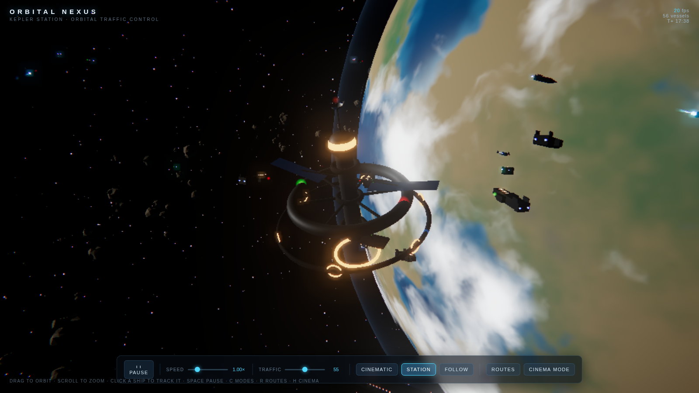
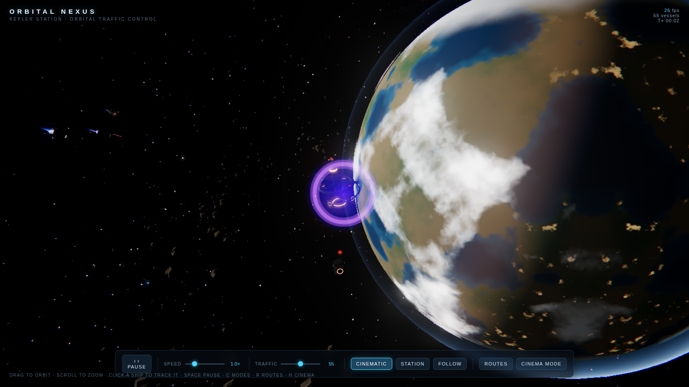
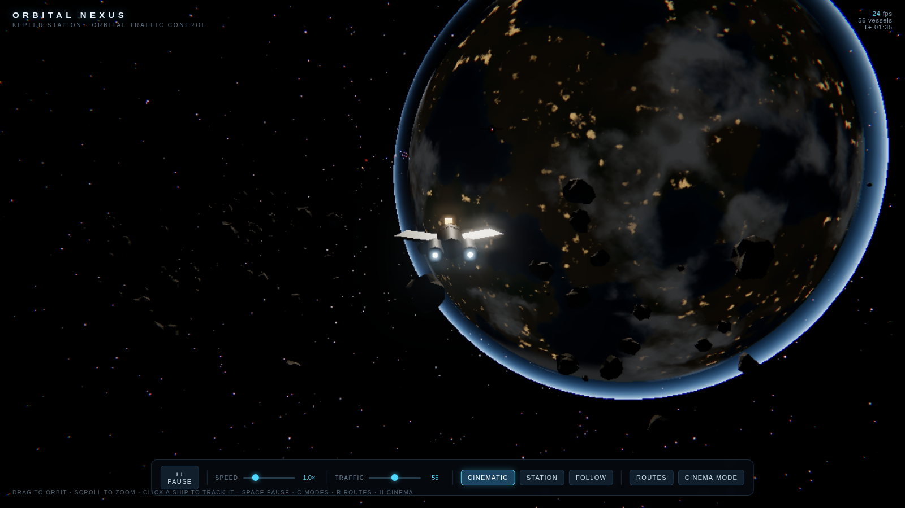
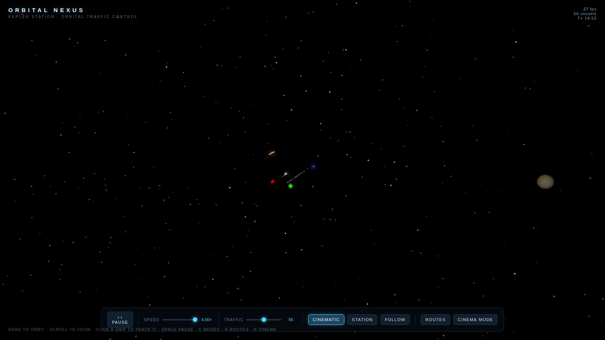
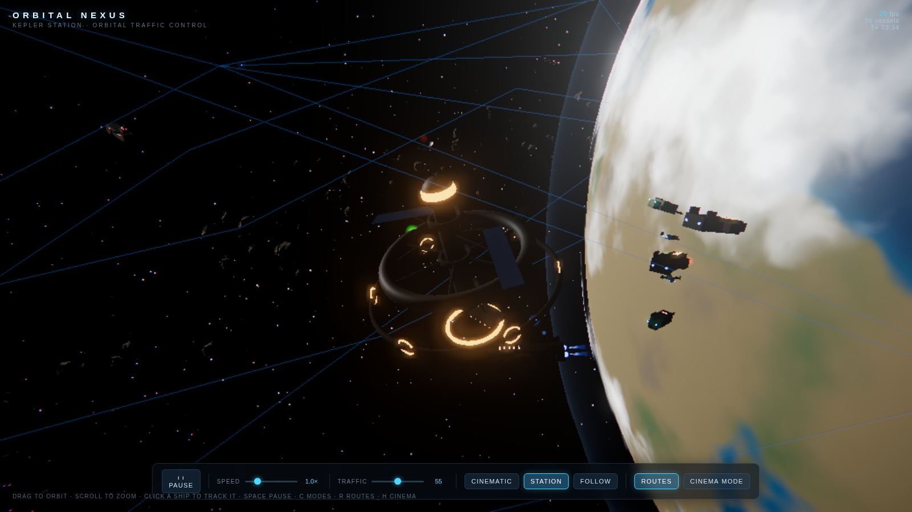
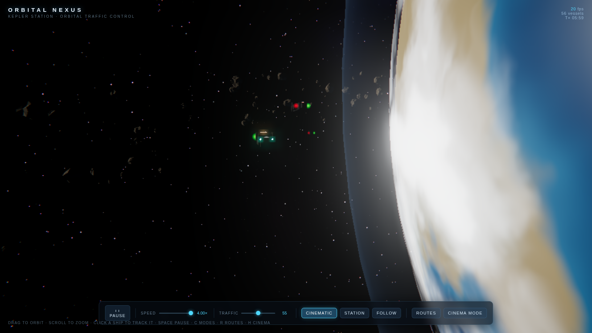

# 🛰️ ORBITAL NEXUS

**A visually spectacular, interactive 3D orbital space simulation that runs directly in your browser.**

No build step, no server-side code, no network required — open `index.html` and watch a living orbital traffic system unfold: a station above a cloud-wrapped planet, dozens of purposeful spacecraft, luminous engine plumes, and a cinematic camera that films it all.



## What's happening

Every vessel runs a real mission lifecycle — departures, travel, queuing, docking, unloading, return journeys — with smooth steering, separation, and traffic reaction:

- 🚛 **Heavy cargo freighters** jump in from four named jump points, slow on approach, queue at docking ports, and haul out again
- 🛩️ **Nimble couriers** run recognizable loops between gates and station
- ⛏️ **Mining vessels** fly out to the asteroid belt, fire bright cutting beams, and return ore to the processing facility
- 🛡️ **Patrol formations** orbit station and occasionally break off to intercept an unidentified vessel
- 🔧 **Maintenance drones** work the station exterior
- 🚀 **Rare capital ships** arrive with an impressive violet jump effect, escorted by couriers



## Propulsion is the star

Luminous engine cores, layered plumes, shimmering particles, and fading trails. Exhaust grows during acceleration, settles at cruise, and diminishes while coasting. Maneuvering thrusters flash on turns and docking burns. Engine light subtly illuminates the hull, and each ship class has its own color within a cohesive cyan/electric-blue palette.



## Cinematic camera

From the first second, a director films the scene: slow orbital sweeps, gentle dollies through traffic, close flybys, tracking shots alongside freighters, mining watches, and pull-backs on capital arrivals — all with smooth eased transitions and no abrupt cuts.



## Interaction

- **Drag** to orbit, **scroll** to zoom — takes over from the auto camera smoothly
- **Resume cinematic** continues from your current viewpoint without snapping
- **Click any ship** to follow it and open an info panel (name, class, destination, task, velocity, range)
- Camera modes: **cinematic overview / station view / ship-follow**
- **Pause**, **sim-speed** (0.25–4×), and **traffic-density** controls
- Optional **route overlay** (hidden by default) reveals the jump-point traffic network
- **Cinema mode** hides the UI for a clean, film-like view



## Running it

Just open `index.html` in any modern browser (WebGL2 required). Everything — including three.js — is vendored in the repo, so it works fully offline.

Optionally serve it locally:

```bash
python3 tools/serve.py 8123
# then open http://127.0.0.1:8123/index.html
```

## Under the hood

- **three.js r170** (vendored) with a post chain: ACES filmic tone mapping → restrained UnrealBloom → vignette + chromatic aberration grade
- Fully **procedural assets**: planet/cloud/atmosphere/star shaders (value-noise fbm), merged per-class ship geometry, procedural nebula and glow textures
- **Instancing** for the asteroid belt and station windows; shared hull geometries per class; ribbon-mesh trails; pooled particle/flash/jump FX
- **Adaptive quality** — three tiers driven by a rolling FPS average tune pixel ratio, bloom, particles, and trail distance
- Waypoint-graph fleet AI with per-class state machines (jump-in, cruise, hold, approach, dock, mine, intercept, escort, EVA…)



## License

MIT
